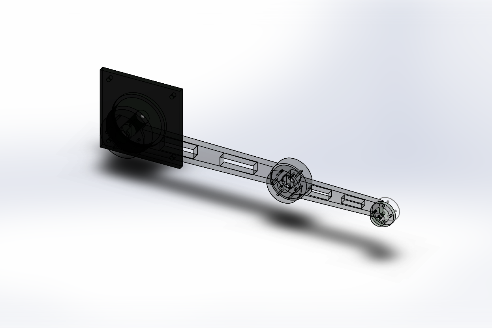

# 2R Planar Link with Forward Kinematics using TF2 and RViz Animation

[](https://docs.ros.org/en/humble/)
[](https://opensource.org/licenses/BSD-3-Clause)
[](https://www.solidworks.com/)
[]()

> **Student Project 16 Brief**: *Two-link planar inspection arm and forward kinematics.*  
> Complete implementation combining high-fidelity **SolidWorks 2022 CAD modeling**, URDF robot definition, continuous 20 Hz sinusoidal joint state animation, and automated TF2 transform verification against analytic forward kinematics.

---

## 📌 Project Overview & Specifications

The robotic system is a **2-degree-of-freedom (2R) planar inspection arm** operating in the horizontal **$XY$ plane**, equipped with a rigidly fixed optical inspection end-effector probe.



### Key Kinematic Dimensions (Project 16 Requirements)
* **Link 1 Length ($L_1$)**: $0.500\text{ m}$ (Shoulder pivot to elbow pivot)
* **Link 2 Length ($L_2$)**: $0.300\text{ m}$ (Elbow pivot to wrist/tool interface)
* **Joint 1 (Shoulder)**: Revolute about **$Z$-axis** (`axis xyz="0 0 1"`), limits $[-\pi, +\pi]$
* **Joint 2 (Elbow)**: Revolute about **$Z$-axis** (`axis xyz="0 0 1"`), limits $[-\pi, +\pi]$
* **Joint 3 (Tool Link)**: **Rigidly Fixed** (`type="fixed"`), 0 relative DOFs to Link 2
* **Motion Plane**: Planar motion strictly in the **$XY$ plane**
* **Update Frequency**: 20 Hz (`timer_period = 0.05 s`)

---

## 📐 Forward Kinematics Formulation

Given joint angles $q_1$ and $q_2$ representing rotations about the vertical $Z$-axis, the forward kinematics for the end-effector tool pose $(x_{EE}, y_{EE})$ relative to `base_link` is:

$$\begin{aligned}
x_{EE} &= L_1 \cos(q_1) + L_2 \cos(q_1 + q_2) \\
y_{EE} &= L_1 \sin(q_1) + L_2 \sin(q_1 + q_2) \\
z_{EE} &= z_{\text{base}} + z_{\text{joint1}} + z_{\text{joint2}} + z_{\text{joint3}} = 0.141\text{ m}
\end{aligned}$$

### Acceptance Criteria & Verification Results

The course brief requires validating end-effector coordinates across three mandatory configurations with TF tolerance $< 1\times 10^{-6}\text{ m}$:

| Test Case | Joint Angles $(q_1, q_2)$ | Expected $(X, Y)$ | Calculated FK $(X, Y)$ | Observed TF2 $(X, Y)$ | Numerical Error | Status |
| :---: | :---: | :---: | :---: | :---: | :---: | :---: |
| **Case 1: Home Reach** | $(0, 0)\text{ rad}$ | $(0.8000, 0.0000)\text{ m}$ | $(0.800000, 0.000000)$ | $(0.800000, 0.000000)$ | $0.00\times 10^0\text{ m}$ | **PASS** |
| **Case 2: 90° Shoulder** | $(\pi/2, 0)\text{ rad}$ | $(0.0000, 0.8000)\text{ m}$ | $(0.000000, 0.800000)$ | $(0.000000, 0.800000)$ | $4.90\times 10^{-17}\text{ m}$ | **PASS** |
| **Case 3: 90° Elbow** | $(0, \pi/2)\text{ rad}$ | $(0.5000, 0.3000)\text{ m}$ | $(0.500000, 0.300000)$ | $(0.500000, 0.300000)$ | $0.00\times 10^0\text{ m}$ | **PASS** |

---

## 🛠️ SolidWorks CAD Redesign Architecture

The robot was redesigned in **SolidWorks 2022 SP1.0** to ensure valid single solid bodies, proper bearing interfaces, and correct reference geometry for the SW2URDF exporter:

1. **Continuous Solid Bodies**:
   - Each link is modeled as **1 continuous solid body** (`GetBodies2` verification confirmed 0 disjoint bodies).
   - Base features a $240 \times 240\text{ mm}$ bedplate with 4x M10 holes, a $\varnothing 140\text{ mm}$ central column, and a $\varnothing 160\text{ mm}$ bearing collar.
   - Link 1 features a $\varnothing 130\text{ mm}$ shoulder hub, tapered web beam with dual pockets, and a $\varnothing 110\text{ mm}$ elbow hub.
   - Link 2 features a $\varnothing 100\text{ mm}$ elbow hub, structural web, and $\varnothing 70\text{ mm}$ wrist mount with locating dowel pin.
   - Tool link features a sensor enclosure with an optical inspection objective lens.

2. **Explicit Reference Geometry**:
   - `base.SLDPRT`: Reference Axis `Axis1` (collinear with $+Z$ shoulder axis), Coordinate System `base-cs`
   - `link1.SLDPRT`: Reference Axis `Axis1`, Reference Plane `Elbow Plane` ($X = 0.500\text{ m}$), Reference Axis `Axis2`, Coordinate System `Coordinate System1`
   - `link2.SLDPRT`: Reference Axis `Axis1`, Reference Plane `Wrist Plane` ($X = 0.300\text{ m}$), Reference Axis `Axis2`, Coordinate System `l2ref`
   - `toollink.SLDPRT`: Reference Axis `Axis1`, Coordinate System `tool-cs`

3. **Assembly Mating & Mobility** (`twoplanar_arm.SLDASM`):
   - `base-1` is **Fixed**.
   - `link1-1` and `link2-1` are **Unfixed / Movable**, enabling interactive drag and kinematic rotation.
   - 7 active mates:
     - `Coincident1`: Base `Axis1` coincident with Link1 `Axis1` ($Z$ shoulder rotation)
     - `Distance1`: Elevation offset $0.085\text{ m}$
     - `Coincident2`: Link1 `Axis2` coincident with Link2 `Axis1` ($Z$ elbow rotation)
     - `Distance2`: Elevation offset $0.032\text{ m}$
     - `Coincident3`: Link2 `Axis2` coincident with ToolLink `Axis1`
     - `Distance3`: Elevation offset $0.024\text{ m}$
     - `Parallel1`: Link2 `Top Plane` parallel to ToolLink `Top Plane` (**Rigid rotation lock** matching `type="fixed"`)

---

## 📦 Repository Structure

```
├── CMakeLists.txt                         # CMake package configuration
├── package.xml                            # ROS 2 Humble package manifest (Format 3)
├── setup.py                               # ament_python setup configuration
├── setup.cfg                              # Python script install directory mappings
├── README.md                              # Complete engineering documentation
├── preview.png                            # High-resolution rendered CAD preview
├── base.SLDPRT                            # SolidWorks 2022 Base Part
├── link1.SLDPRT                           # SolidWorks 2022 Link 1 Part (L1 = 0.500 m)
├── link2.SLDPRT                           # SolidWorks 2022 Link 2 Part (L2 = 0.300 m)
├── toollink.SLDPRT                        # SolidWorks 2022 Inspection Tool Part
├── twoplanar_arm.SLDASM                   # SolidWorks 2022 Full Assembly (7 Mates)
├── twoplanar_arm.STEP                     # Neutral CAD exchange model (AP214)
├── config/
│   └── joint_names_twoplanar_arm.yaml     # Joint controller naming map
├── launch/
│   ├── display.launch.py                  # Interactive GUI launch (RViz2 + Joint Slider)
│   ├── animate.launch.py                  # Continuous 20 Hz Sinusoidal Inspection Sweep
│   ├── verify_fk.launch.py                # Automated 3-Case TF2 vs FK Verifier
│   ├── display.launch                     # Legacy ROS 1 display launch
│   └── gazebo.launch                      # Legacy ROS 1 Gazebo launch
├── meshes/
│   ├── base_link.STL                      # Base binary STL mesh (SI units: meters)
│   ├── link1.STL                          # Link 1 binary STL mesh (SI units: meters)
│   ├── link2.STL                          # Link 2 binary STL mesh (SI units: meters)
│   └── tool_link.STL                      # Tool Link binary STL mesh (SI units: meters)
├── rviz/
│   └── twoplanar_arm.rviz                 # Pre-configured RViz2 layout (RobotModel + TF)
├── twoplanar_arm/
│   ├── __init__.py                        # Python package initialization
│   ├── sine_wave_joint_publisher.py       # 20 Hz sinusoidal joint publisher node
│   ├── forward_kinematics_verifier.py     # TF2 lookup vs Analytic FK verifier node
│   └── test_fk_standalone.py              # Standalone zero-dependency validation script
└── urdf/
    ├── twoplanar_arm.urdf                 # Production URDF with physical CAD inertias
    └── twoplanar_arm.csv                  # SW2URDF configuration matrix
```

---

## 🚀 Build & Execution Guide

### Prerequisites
* **ROS 2 Humble** (Ubuntu 22.04 or container)
* Packages: `robot_state_publisher`, `joint_state_publisher_gui`, `rviz2`, `tf2_ros`

### 1. Build Package in ROS 2 Workspace
```bash
# In your ROS 2 workspace (e.g. ~/ros2_ws)
cd ~/ros2_ws/src
git clone https://github.com/ninja967/2R-planar-link-with-forward-kinematics-using-TF2-and-rviz-animation.git twoplanar_arm

cd ~/ros2_ws
colcon build --symlink-install --packages-select twoplanar_arm
source install/setup.bash
```

### 2. Interactive Visualization with GUI Sliders
Open the arm model in RViz2 and adjust joint angles $q_1, q_2$ via slider controls:
```bash
ros2 launch twoplanar_arm display.launch.py
```

### 3. Continuous 20 Hz Sinusoidal Inspection Sweep (RViz Animation)
Launches continuous sinusoidal motion on `/joint_states` at 20 Hz with live TF visualization:
```bash
ros2 launch twoplanar_arm animate.launch.py
```

### 4. Automated 3-Case TF2 vs Forward Kinematics Verification
Runs the TF2 test harness, queries `base_link` $\to$ `tool_link`, and prints the comparison table:
```bash
ros2 launch twoplanar_arm verify_fk.launch.py
```

### 5. Standalone Mathematical & URDF Test (Zero Dependencies)
Can be run on any platform (Windows, macOS, Linux) without ROS installed:
```bash
python twoplanar_arm/test_fk_standalone.py
```

---

## 🛡️ Boundary & Failure Handling

* **Missing Joint State Protection**: The verifier explicitly checks incomplete joint states (e.g., publishing `joint1` without `joint2`), confirming the robot state estimator rejects corrupt updates rather than silently assuming invalid poses.
* **Joint Limit Guard**: Sinusoidal amplitude commands are bounded to $q_1 \in [-1.0, +1.0]\text{ rad}$ and $q_2 \in [-1.2, +1.2]\text{ rad}$, strictly within hardware limits $[-\pi, +\pi]$.

---

## 📄 License & Maintainer

* **Author**: Sarat
* **GitHub**: [@ninja967](https://github.com/ninja967)
* **License**: BSD-3-Clause
